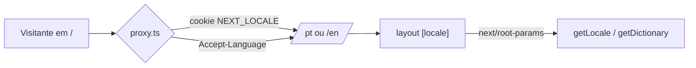

# Arquitetura

Site estático em sua maior parte: as páginas `/pt`, `/en` e os estudos de caso são pré-renderizados
no build. O único trecho dinâmico é a Server Action do formulário de contato.

## Rotas

| Rota                          | Arquivo                                     | Observação                      |
| ----------------------------- | ------------------------------------------- | ------------------------------- |
| `/`                           | `src/proxy.ts`                              | redireciona para `/pt` ou `/en` |
| `/[locale]`                   | `src/app/[locale]/page.tsx`                 | home com todas as seções        |
| `/[locale]/projects/[slug]`   | `src/app/[locale]/projects/[slug]/page.tsx` | estudo de caso (SSG)            |
| `/[locale]/opengraph-image`   | `src/app/[locale]/opengraph-image.tsx`      | imagem de compartilhamento      |
| `/sitemap.xml`, `/robots.txt` | `src/app/sitemap.ts`, `robots.ts`           |                                 |
| qualquer outra                | `src/app/global-not-found.tsx`              | 404 fora do layout por idioma   |

O root layout fica em `src/app/[locale]/layout.tsx` (fontes, tema, header, footer, metadados).

## Idioma (i18n)



- Configuração e negociação: `src/i18n/config.ts`.
- Dicionários: `src/i18n/messages/*.json`, carregados no servidor por `src/i18n/dictionaries.ts`
  usando `next/root-params` (sem prop drilling). Client Components recebem os textos por props.
- Conteúdo pessoal bilíngue usa `Localized<T>` (`src/lib/types.ts`). Detalhes: [ADR 0001](adr/0001-i18n-nativo-com-root-params.md).

## Tema claro/escuro

- Script inline no `<head>` (`src/lib/theme-script.ts`) aplica a classe `dark` antes da primeira
  pintura: escolha salva no `localStorage` ou, sem escolha, a preferência do sistema.
- `src/lib/theme.ts`: hook `useTheme` (para o Sonner) e `setTheme`, com transição circular via
  View Transitions API. Detalhes: [ADR 0002](adr/0002-tema-com-script-inline.md).
- Tokens de cor em `src/app/globals.css` (`:root` claro, `.dark` escuro).

## Formulário de contato

`contact-form.tsx` (cliente: React Hook Form + Zod) → `sendContact` em `src/app/actions/contact.ts`
(servidor): revalida com o mesmo schema (`src/lib/schemas.ts`), descarta bots pelo honeypot,
aplica rate limit em memória (3 envios/IP/10 min) e envia dois e-mails por `src/lib/mailer.ts`
(SMTP via nodemailer, ou Resend): o aviso para o dono (`replyTo` = visitante) e uma
confirmação para o visitante, no idioma da página (textos em `contact.confirmation`, montados em
`src/lib/contact-mail.ts`). A confirmação não repete nada do que foi digitado e é limitada a
2 por endereço/hora, para o formulário não virar ferramenta de spam; se ela falhar, o envio
continua valendo. Sem provedor configurado, em desenvolvimento a mensagem só é registrada no
terminal e em produção a resposta é 503.

## Conceito e componentes

A home é percorrida como uma requisição atravessando um sistema
([ADR 0004](adr/0004-conceito-ciclo-de-vida-da-requisicao.md)). A configuração dos hops (nome,
span e latência de cada seção) fica em `src/components/layout/nav-items.ts` e alimenta o header,
o trilho lateral, o trace waterfall e os cabeçalhos das seções.

```
src/components/
  ui/        shadcn/ui (button, input, textarea, label, sheet, sonner)
  layout/    header (+ barra de progresso), menu mobile, idioma, tema, footer, nav-items
  sections/  hero, about, stack, experience, projects, contact (+ contact-form: console de API)
  system/    peças do conceito:
             request-rail       trilho fixo com o "pacote" guiado pelo scroll (xl+)
             architecture-diagram  diagrama vivo do hero (dados em src/content/system.ts)
             trace-waterfall    índice da página como trace distribuído
             knowledge-graph    grafo interativo da stack (dados de src/lib/graph.ts)
             commit-line        linha do git log desenhada no scroll
             horizontal-track   fila de projetos: trilho horizontal (desktop) / carrossel (mobile)
             mini-pipeline      pipeline de arquitetura de um projeto
             system-section     cabeçalho de seção com hop, span e latência
             crosshair          mira de prancheta com coordenadas no hero
  motion/    Reveal, Stagger, ScrambleText, ScrollRevealText, Odometer, Tilt
  hand/      HandNote (anotação manuscrita com seta)
  shared/    CopyEmailButton
```

Dados derivados e puros, com testes em `tests/system.test.ts`:

- `src/lib/graph.ts` — pesos e conexões do grafo a partir de projetos/experiências; layout determinístico.
- `src/lib/hash.ts` — hashes curtos determinísticos (ids de commit, trace id).
- `src/lib/http.ts` — status HTTP do console de contato e literais JSON da pré-visualização.

Outros pontos de implementação:

- `src/app/api/whatsapp/route.ts` — redireciona para o WhatsApp; o número vem de
  `CONTACT_WHATSAPP` via `src/lib/whatsapp.ts` (`server-only`, nunca vai ao cliente). Normalização
  e formatação são puras em `src/lib/phone.ts` (testes em `tests/phone.test.ts`).
- `src/lib/rate-limit.ts` — rate limit em memória do contato (janela deslizante, com limpeza
  de chaves expiradas), testado em `tests/rate-limit.test.ts`.
- `src/proxy.ts` também reescreve slugs de projeto inexistentes para uma rota sem
  correspondência, devolvendo 404 real (com a pré-renderização parcial, o `notFound()` da página
  chegaria tarde demais para mudar o status).
- A altura da fila de projetos no desktop é calculada em CSS (`.track-*` em `globals.css`),
  para o HTML do servidor já chegar com o layout final.
- `ThemeSync` reaplica o tema ao trocar de idioma e marca `html[data-hydrated]` (usado pelos
  testes E2E).

Server Components por padrão; componentes cliente só onde há interação. Regras de UI e de
movimento na skill `.claude/skills/frontend-design`.

## Next.js 16: pontos de atenção

- `cacheComponents: true` — `new Date()` em Server Component só dentro de função com `"use cache"`.
- `dynamicParams` não é suportado; slug inexistente chama `notFound()`.
- `middleware` agora é `proxy`.
- Documentação da versão instalada: `node_modules/next/dist/docs/`.
